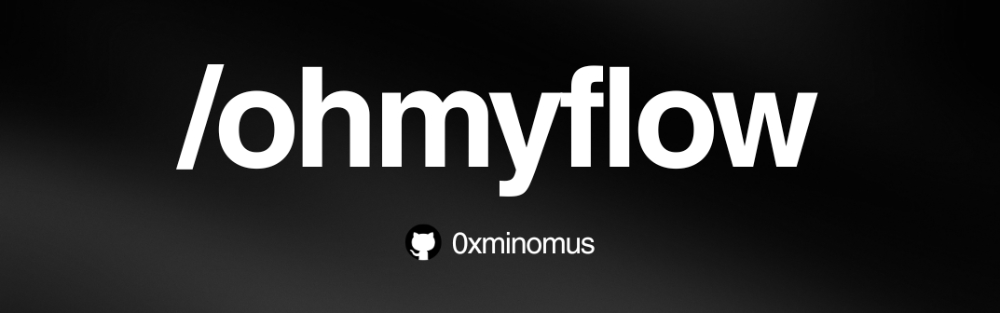
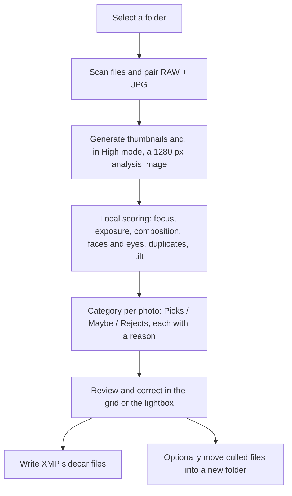

<div align="center">
  
  <p><strong>AI photo culler for Windows. Pick your best shots 10x faster, 100% offline.</strong></p>
  <p>
    
    
    
    
    
  </p>
</div>

---

## Table of Contents

- [About](#about)
- [Features](#features)
- [How It Works](#how-it-works)
- [Culling Modes](#culling-modes)
- [Installation](#installation)
  - [Requirements](#requirements)
  - [Portable Release](#portable-release)
  - [Build From Source](#build-from-source)
  - [Command Reference](#command-reference)
- [Supported File Formats](#supported-file-formats)
- [XMP Export and Lightroom Integration](#xmp-export-and-lightroom-integration)
- [Privacy and Security](#privacy-and-security)
- [Project Structure](#project-structure)
- [Engine Evaluation Harness](#engine-evaluation-harness)
- [Roadmap](#roadmap)
- [Contributing](#contributing)
- [Acknowledgements](#acknowledgements)
- [License](#license)

## About

OhMyFlow is a Windows desktop app that **culls thousands of photos from a shoot in minutes**. Point it at a folder and it sorts everything into three buckets:

| Bucket | Meaning |
|--------|---------|
| 🟢 **Picks** | The best shots: sharp, well exposed, solid composition |
| 🟡 **Maybe** | Borderline shots that deserve a quick human glance |
| 🔴 **Rejects** | Failures: blurry shots, closed eyes, crushed blacks, burst duplicates, blank frames |

Results export as **XMP sidecar files** (Rating 5/3/1 plus Green/Yellow/Red labels), so they show up directly in **Adobe Lightroom, Bridge, and Camera Raw** with no extra steps. Your originals are never moved, modified, or deleted. Only `.xmp` files are written next to them.

All of the AI runs **on your own machine** using ONNX Runtime plus classic computer vision heuristics. No photo ever leaves your computer. No API keys, no cloud, no subscription.

## Features

### Culling engine

- **Three culling modes** — Fast (first pass), Balance (daily driver), and High (final, most thorough selection). Each mode shows a live time estimate for the folder you selected.
- **Dedicated high-resolution analysis in High mode** — instead of upscaling a grid thumbnail, High mode analyzes its own 1280 px render per photo, which is what makes the extra precision possible.
- **Burst and duplicate ranking** — perceptually similar frames are grouped, ranked, and the redundant ones are rejected while a keeper is always preserved.
- **Hard rejects for ruined frames** — High mode refuses to give Picks to photos with destroyed exposure or soft, dim subjects, even when other signals look good.
- **Automatic content detection** — photos of people are judged with face and eye logic (including a bundled ONNX face model for hard cases), while smooth object shots (product, ceramics, food) are judged on exposure, composition, and color, avoiding false "closed eyes" verdicts.
- **Multi-signal scoring** — focus sharpness (Laplacian variance, subject sharpness, edge density), motion hints, exposure and highlight/shadow clipping, white balance, framing and composition, tilt, perceptual-hash duplicates, and eye state.
- **A reason for every photo** — each decision ships with a short explanation in Indonesian and English (for example *"Blurry / out of focus"* or *"Similar frame — another version is better"*). No verdict is ever silent.

### Review workflow

- **Manual sorting** — review grid and fullscreen lightbox with centered verdict buttons and a live status badge.
- **Keyboard shortcuts** — defaults are `Q` / `W` / `E` for Picks / Maybe / Rejects, arrow keys to move, `Esc` to close the lightbox. Every binding is remappable.
- **Controller support** — PlayStation, Xbox, and generic gamepads work out of the box (L1/R1 to move, Square/Triangle/Circle to rate) and are fully remappable.
- **Bilingual UI** — Indonesian and English, switchable at any time.
- **Lazy thumbnails with disk cache** — folders with thousands of photos stay light and fast; the cache can be cleared from Settings.

### Files and output

- **RAW+JPG pairing** — pairs like `IMG_1234.CR3` + `IMG_1234.JPG` are treated as one photo with one shared rating and a single sidecar.
- **Move culled files** — move Picks (optionally including Maybe) into a fresh folder. RAW+JPG pairs and `.xmp` files come along, and name collisions get numbered automatically.
- **Non-destructive by design** — culling and XMP export never modify, move, or delete your originals.

## How It Works



1. **Pick a folder** — from local disk or straight off a memory card.
2. **Pick a mode** — Fast, Balance, or High (each shows an estimate for your photo count).
3. **Start culling** — the AI works locally, with live progress you can cancel at any time.
4. **Review** — filter by Picks, Maybe, or Rejects and correct anything with one click or in the lightbox.
5. **Export** — write XMP for Lightroom, and optionally move your Picks into a new folder.

## Culling Modes

| Mode | Analysis size | Batch size | In-app estimate | What it does |
|------|---------------|------------|-----------------|--------------|
| **Fast** | 256 px | 8 | ~900 photos/min | First pass. Only clearly failed shots are rejected. |
| **Balance** | 384 px | 6 | ~500 photos/min | Balanced for daily use. Full Picks / Maybe / Rejects. |
| **High** | 512 px | 4 | ~250 photos/min | Final selection. Adds the 1280 px analysis image, burst ranking, and hard rejects for blur, weak composition, and duplicates. |

Estimates are computed by the app from your photo count and shown next to each mode before you start. Actual speed depends on your CPU, the image sizes, and whether the files are RAW or JPEG.

## Installation

### Requirements

- **Windows 10 or 11, 64-bit.**
- **[Node.js](https://nodejs.org/) 20 or newer** — only needed to build from source.
- Photo processing runs on your CPU through ONNX Runtime WebAssembly. No GPU, no account, no extra codec pack.
- Internet access is only required to download a release or to install the build dependencies.

### Portable Release

1. Open the [Releases](https://github.com/0xMinomus/OhMyFlow/releases/latest) page and download the latest portable build (currently `OhMyFlow-v1.2-portable-win32-x64.zip`, around 143 MB).
2. Right-click the zip, choose **Extract All**, and pick a destination folder.
3. Open the extracted folder and double-click **`OhMyFlow.exe`**.

The build is portable: no installer, no admin rights. Because the app is not code-signed yet, Windows SmartScreen may warn you — click **More info**, then **Run anyway**.

### Build From Source

```bash
git clone https://github.com/0xMinomus/OhMyFlow.git
cd OhMyFlow
npm ci

# development: Vite dev server plus the Electron app, with hot reload
npm run dev

# portable Windows build (lands in release/OhMyFlow-win32-x64/OhMyFlow.exe)
npm run pack
```

`npm ci` installs exactly the dependency versions recorded in `package-lock.json`. The build writes the renderer to `dist/`, the Electron main process and preload script to `dist-electron/`, and the ONNX Runtime WebAssembly files to `dist/ort/`.

> Tip: for a quick end-to-end tour, point the app at the `test-photos/` folder — sample images are included in this repository.

### Command Reference

| Command | What it does |
|---------|--------------|
| `npm run dev` | Vite dev server on port 5173 plus Electron; hot reload for the UI and an automatic restart for the main process |
| `npm run build` | Type-check with `tsc`, build the renderer to `dist/`, build the main process and preload to `dist-electron/`, and copy the ONNX runtime files to `dist/ort/` |
| `npm run build:electron` | Build only the Electron main process and preload script |
| `npm start` | Launch `dist-electron/main.js` from an existing build — run `npm run build` first |
| `npm run preview` | Preview the production renderer build |
| `npm run pack` | Full build plus `electron-packager` output for Windows x64 in `release/OhMyFlow-win32-x64/` |
| `npm run dist:win` | Full build plus an `electron-builder` NSIS installer for Windows x64 |

## Supported File Formats

| Category | Extensions |
|----------|-----------|
| Standard | `.jpg` `.jpeg` `.png` `.tiff` `.tif` `.webp` `.bmp` |
| Apple | `.heic` `.heif` |
| RAW | `.cr2` `.cr3` `.nef` `.arw` `.raf` `.dng` `.rw2` `.orf` `.pef` |

`.xmp` files are ignored during scanning, so existing sidecars never show up as photos. RAW files without an embedded JPEG preview are still processed and clearly marked, and their ratings are written to XMP like any other photo.

## XMP Export and Lightroom Integration

Every export writes one `.xmp` sidecar next to the original photo — never into a central database:

| Verdict | `xmp:Rating` | `xmp:Label` | Hierarchical keyword |
|---------|--------------|-------------|----------------------|
| Picks | 5 | Green | `OhMyFlow/Green` |
| Maybe | 3 | Yellow | `OhMyFlow/Yellow` |
| Rejects | 1 | Red | `OhMyFlow/Red` |

- Adobe Bridge and Camera Raw pick the sidecars up as soon as the folder is browsed.
- In Lightroom Classic, use **Metadata → Read Metadata from File** (or import the folder) to load them.
- RAW+JPG pairs share one basename and therefore one sidecar, so a pair keeps a single rating.

## Privacy and Security

- **Fully offline** — photo processing makes zero network requests. The app never needs the internet after setup.
- **No API keys, no cloud, no telemetry, no analytics** — there is nothing to collect, and nothing to leak.
- **All inference runs locally on the CPU** through ONNX Runtime WebAssembly. No GPU acceleration, no remote service, no per-photo upload.
- **Renderer isolation** — `contextIsolation` is on, `nodeIntegration` is off, and the UI is served over a custom `app://` protocol. All disk access goes through a minimal `window.ohmyflow` bridge handled by the main process.
- **Non-destructive** — culling and XMP export never modify, move, or delete originals. The *Move files* action is explicit: it always shows the destination and file count first, then numbers duplicate names automatically.

For the full security model, including the model supply chain and path-traversal protections, see [SECURITY.md](SECURITY.md). To report a vulnerability, follow the policy there instead of opening a public issue with details.

## Project Structure

```
OhMyFlow/
├── electron/
│   ├── main.ts          # Main process: IPC, folder scan, RAW+JPG pairing,
│   │                    #   thumbnail and analysis caches, XMP writer, file mover
│   └── preload.ts       # Secure renderer-to-main bridge (contextBridge)
├── src/
│   ├── components/      # UI: folder picker, mode selector, grid, lightbox,
│   │                    #   move modal, settings panel, header
│   ├── lib/
│   │   ├── ai-engine/   # Culling engine: blur, aesthetic, composition, duplicate,
│   │   │                #   face, subject, motion, tilt, pipeline, reasons, and
│   │   │                #   culler (orchestration plus per-mode presets)
│   │   ├── ml/          # Local ONNX face detector (fail-safe) and eye ROI helpers
│   │   ├── gamepad.ts   # Controller support (no dependencies)
│   │   └── thumbCache.ts
│   ├── store/           # App state: settings, keybinds, controller binds
│   └── types/
├── public/
│   ├── models/          # Bundled ONNX face model (MIT licensed)
│   └── *.jpg, *.png     # Banner, app logo, hero image
├── scripts/             # ONNX WebAssembly copy helper and the evaluation harness
├── build/               # icon.ico and Windows packaging assets
└── test-photos/         # Sample photos for a quick trial run
```

## Engine Evaluation Harness

Culling changes should be measured, not guessed. The repository ships a Node harness that runs the **production engine code** over a labeled folder:

```bash
# 1. Build ground truth from a labeled folder (sample/ is git-ignored)
node scripts/read-sample.cjs [sample]

# 2. Run the engine and score it against that ground truth
node scripts/eval-gt.cjs [--split human|nonhuman|all] [--limit N] [--mode high]

# 3. Break the resulting CSV down (danger, waste, eye, and best cases)
node scripts/analyze-eval.cjs [--eval sample/eval-high.csv]
```

- Ground truth is encoded by folder layout: `sample/human|nonhuman/{picks,maybe,rejects}/<file>`.
- Duplicate and eye tags use the `_b/` (best in burst) and `_eye/` (closed eyes) conventions.
- Output is `sample/eval-<mode>.csv` plus metrics and a determinism hash over the verdicts.
- The harness decodes images with `sharp` and bundles the engine with `esbuild`; both are installed by `npm ci`.

## Roadmap

- [ ] Next-level blink detection (lash-line modeling) for wedding candids
- [ ] Full RAW preview decoding (embedded JPEG extraction)
- [ ] SQLite database for correction history and taste learning
- [ ] Auto-update via `electron-updater`
- [ ] Signed NSIS installer (the `electron-builder` target is already configured)

## Contributing

Contributions are welcome. Fork the repo, create a branch (`git checkout -b feature/my-feature`), keep commits focused, and open a pull request.

- For changes to culling behavior, include **before/after numbers from the evaluation harness** on the same folder, so the change can be reviewed objectively.
- For UI changes, describe what you tested manually.
- Report security issues through [SECURITY.md](SECURITY.md) rather than a public issue.

## Acknowledgements

- **UltraFace RFB-320** by Linzaer (MIT licensed) — the bundled face detection model.
- **ONNX Runtime Web** — local WebAssembly inference.
- **Electron** (with React, Vite, and Tailwind CSS) — the desktop shell and UI.
- **sharp** — image decoding and thumbnail generation in the main process.

Each dependency is distributed under its own license; see the respective project for details.

## License

OhMyFlow is open source software licensed under the [MIT License](LICENSE).

You are free to use, copy, modify, merge, publish, distribute, sublicense, and sell copies of the software, including for commercial purposes, as long as the original copyright notice and license text are included with any substantial portion of it.

Copyright (c) 2026 0xMinomus. See [LICENSE](LICENSE) for the full legal text.
