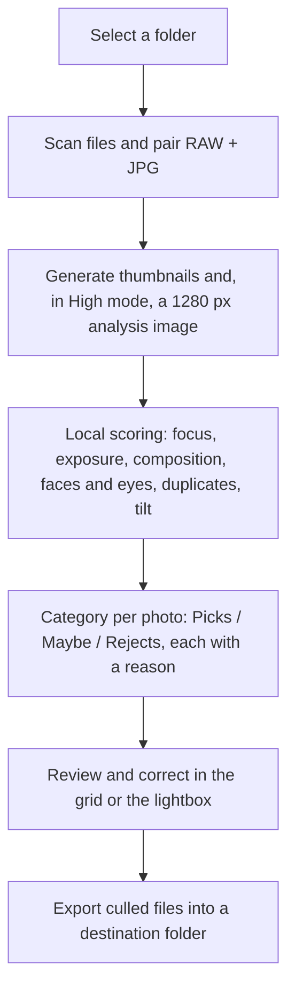

<div align="center">
  
  <p><strong>AI photo culler for Windows & Linux. Pick your best shots 10x faster, 100% offline.</strong></p>
  <p>
    
    
    
    
    
  </p>
</div>

---

## What's New in v2.0

- 🚀 **Tauri 2 + Native Rust Engine:** Complete rewrite replacing Electron. Binary size dropped from **316 MB to 22.7 MB** (Windows `.exe`) and **27.7 MB** (Linux standalone), with 41% lower idle RAM.
- ⚡ **Multi-Threaded Parallel Culling (`rayon`):** Culling utilizes all CPU cores in parallel with native SIMD image decoding, delivering ~3×–5× faster throughput without requiring any GPU or RTX hardware.
- 🧠 **Pure-Rust Offline ONNX (`tract-onnx`):** UltraFace RFB-320 is embedded directly into the binary with compile-time SHA-256 verification. Zero WebAssembly overhead, 100% offline.
- 📷 **Embedded JPEG RAW-Only Preview:** Full-size embedded previews are extracted natively from camera RAW files (`.RAF`, `.CR2`, `.CR3`, `.NEF`, `.ARW`, etc.) without external CLI tools, enabling full AI culling and instant Lightbox previews for RAW-only workflows.
- 🏎️ **Native `media://` Streaming:** Eliminated heavy base64 IPC encoding. Full-res 1:1 previews stream directly from disk with debounced neighbor pre-decoding (<15 ms switch latency).
- 🗂️ **Grid Sorting & Burst Compare:** Sort the review grid by Name, Score, Focus, or Burst Group. Compare burst peers side-by-side in Lightbox with `[ Bandingkan Burst · B ]`.
- ↩️ **Undo & Session Restore:** Full `Ctrl+Z` / `Cmd+Z` undo stack and automatic per-folder session saving to resume review anytime.
- 📦 **Simplified Export:** Streamlined export action moving selected buckets (`Picks`, `Maybe`, `Rejects`) into clean destination folders.

---

## Table of Contents

- [What's New in v2.0](#whats-new-in-v20)

- [About](#about)
- [Features](#features)
- [How It Works](#how-it-works)
- [Culling Modes](#culling-modes)
- [Installation](#installation)
  - [Requirements](#requirements)
  - [Portable Release](#portable-release)
  - [Build From Source](#build-from-source)
  - [Command Reference](#command-reference)
- [Supported File Formats](#supported-file-formats)
- [Privacy and Security](#privacy-and-security)
- [Project Structure](#project-structure)
- [Engine Evaluation Harness](#engine-evaluation-harness)
- [Roadmap](#roadmap)
- [Contributing](#contributing)
- [Acknowledgements](#acknowledgements)
- [License](#license)

## About

OhMyFlow is a Windows and Linux desktop app that **culls thousands of photos from a shoot in minutes**. Point it at a folder and it sorts everything into three buckets:

| Bucket | Meaning |
|--------|---------|
| 🟢 **Picks** | The best shots: sharp, well exposed, solid composition |
| 🟡 **Maybe** | Borderline shots that deserve a quick human glance |
| 🔴 **Rejects** | Failures: blurry shots, closed eyes, crushed blacks, burst duplicates, blank frames |

Your originals are never touched or modified during culling. When you are ready, export your selected buckets (`Picks`, `Maybe`, or `Rejects`) into a clean destination folder (with optional per-bucket subfolders).

All of the AI runs **100% on your own machine** using a native multi-threaded Rust engine (`rayon`), SIMD-accelerated image decoding (`image`, `fast_image_resize`), and embedded ONNX face inference (`tract-onnx`). No photo ever leaves your computer. No API keys, no cloud, no subscription, and zero GPU/RTX required.

## Features

### Culling engine

- **Three culling modes** — Fast (first pass), Balance (daily driver), and High (final, most thorough selection). Each mode shows a live time estimate for the folder you selected.
- **Dedicated high-resolution analysis in High mode** — instead of upscaling a grid thumbnail, High mode analyzes its own 1280 px render per photo, which is what makes the extra precision possible.
- **Burst and duplicate ranking** — perceptually similar frames are grouped, ranked, and the redundant ones are rejected while a keeper is always preserved.
- **Hard rejects for ruined frames** — High mode refuses to give Picks to photos with destroyed exposure or soft, dim subjects, even when other signals look good.
- **Automatic content detection** — photos of people are judged with face and eye logic (including a bundled ONNX face model for hard cases), while smooth object shots (product, ceramics, food) are judged on exposure, composition, and color, avoiding false "closed eyes" verdicts.
- **Multi-signal scoring** — focus sharpness (Laplacian variance, subject sharpness, edge density), motion hints, exposure and highlight/shadow clipping, white balance, framing and composition, tilt, perceptual-hash duplicates, and eye state.
- **A reason for every photo** — each decision ships with a short explanation in Indonesian and English (for example *"Blurry / out of focus"* or *"Similar frame — another version is better"*). No verdict is ever silent.

### Review workflow

- **Manual sorting** — review grid and fullscreen lightbox with centered verdict buttons and a live status badge.
- **Keyboard shortcuts** — defaults are `Q` / `W` / `E` for Picks / Maybe / Rejects, arrow keys to move, `Esc` to close the lightbox. Every binding is remappable.
- **Controller support** — PlayStation, Xbox, and generic gamepads work out of the box (L1/R1 to move, Square/Triangle/Circle to rate) and are fully remappable.
- **Bilingual UI** — Indonesian and English, switchable at any time.
- **Lazy thumbnails with disk cache** — folders with thousands of photos stay light and fast; the cache can be cleared from Settings.

### Files and output

- **RAW+JPG pairing** — pairs like `IMG_1234.CR3` + `IMG_1234.JPG` are treated as one photo with a single verdict.
- **Export culled photos** — move Picks (and optionally Maybe/Rejects) into a fresh folder or separate `Picks/Maybe/Rejects` subfolders. RAW+JPG pairs come along, and name collisions get numbered automatically.
- **Non-destructive culling** — scanning and culling never modify, move, or delete your originals.

## How It Works



1. **Pick a folder** — from local disk or straight off a memory card.
2. **Pick a mode** — Fast, Balance, or High (each shows an estimate for your photo count).
3. **Start culling** — the AI works locally, with live progress you can cancel at any time.
4. **Review** — filter by Picks, Maybe, or Rejects and correct anything with one click or in the lightbox.
5. **Export** — move your Picks (or chosen buckets) into a new folder, optionally split into subfolders.

## Culling Modes

| Mode | Analysis size | Batch size | In-app estimate | What it does |
|------|---------------|------------|-----------------|--------------|
| **Fast** | 256 px | 8 | ~900 photos/min | First pass. Only clearly failed shots are rejected. |
| **Balance** | 384 px | 6 | ~500 photos/min | Balanced for daily use. Full Picks / Maybe / Rejects. |
| **High** | 512 px | 4 | ~250 photos/min | Final selection. Adds the 1280 px analysis image, burst ranking, and hard rejects for blur, weak composition, and duplicates. |

Estimates are computed by the app from your photo count and shown next to each mode before you start. Actual speed depends on your CPU, the image sizes, and whether the files are RAW or JPEG.

## Installation

### Requirements

- **Windows 10/11 or Linux (x64).**
- **[Node.js](https://nodejs.org/) 20 or newer** and **[Rust](https://rustup.rs/) 1.80 or newer** — only needed to build from source.
- Photo processing runs 100% natively on your CPU through a multi-threaded Rust engine with SIMD acceleration (`rayon`, `image`, `fast_image_resize`) and embedded ONNX inference (`tract-onnx`). No GPU, no RTX, no account, no extra codec pack needed.
- Internet access is only required to download a release or to install the build dependencies.

### Portable Release

1. Open the [Releases](https://github.com/0xMinomus/OhMyFlow/releases/latest) page and download the build for your platform:
   - **Windows:** `OhMyFlow-windows-x64.exe` (standalone single-file executable, ~22.7 MB)
   - **Linux AppImage:** `OhMyFlow-2.0.0.AppImage` (portable all-in-one package, ~116 MB)
   - **Linux Standalone:** `ohmyflow-linux-x64` (native binary for systems with WebKitGTK, ~27.7 MB)
2. Run the executable directly.

The build is portable: no installer required, no admin rights. On Windows, if SmartScreen prompts, click **More info** → **Run anyway**.

### Build From Source

```bash
git clone https://github.com/0xMinomus/OhMyFlow.git
cd OhMyFlow
npm ci

# development: Vite dev server plus Tauri 2 desktop shell, with hot reload
npm run tauri:dev

# production Linux bundle (lands in src-tauri/target/release/bundle/appimage/)
npm run tauri:build

`npm ci` installs the frontend build dependencies. Running `npm run tauri:build` compiles the Vite frontend to `dist/` and links the native Rust backend into `src-tauri/target/release/ohmyflow` (Linux) or cross-compiles Windows binaries via `npm run tauri:build:win`.

> Tip: `test-photos/` holds solid-colour test images for smoke-testing the UI — not real photos for judging culling quality.

### Command Reference

| Command | What it does |
|---------|--------------|
| `npm run dev` | Launch Vite dev server alone |
| `npm run tauri:dev` | Launch Vite dev server and Tauri desktop app with hot reload |
| `npm run typecheck` | Type-check frontend TypeScript (`tsconfig.json`) |
| `npm test` | Run native Rust engine unit and integration test suite (`cargo test --test engine_tests`) |
| `npm run build` | Build frontend production bundle to `dist/` |
| `npm run tauri:build` | Build production Linux release executable and AppImage package |
| `npm run tauri:build:win` | Cross-compile production Windows x64 binary via `cargo-xwin` |
## Supported File Formats

| Category | Extensions |
|----------|-----------|
| Standard | `.jpg` `.jpeg` `.png` `.tiff` `.tif` `.webp` `.bmp` |
| RAW | `.cr2` `.cr3` `.nef` `.arw` `.raf` `.dng` `.rw2` `.orf` `.pef` |

`.xmp` files are ignored during scanning, so existing sidecars never show up as photos.

`.heic` / `.heif` is experimental: decoding needs an HEVC decoder from libheif, and the official sharp builds do not necessarily ship one. Files that fail to decode land in Maybe.

RAW files without an embedded JPEG preview are flagged and land in Maybe — they are not analyzed.

## Privacy and Security

- **Fully offline** — photo processing makes zero network requests. The app never needs the internet after setup.
- **No API keys, no cloud, no telemetry, no analytics** — there is nothing to collect, and nothing to leak.
- **All inference runs locally on the CPU** through native Rust and `tract-onnx` with compile-time SHA-256 model verification. No WebAssembly overhead, no remote service, no GPU/RTX needed.
- **Process isolation** — Tauri 2 webview frontend with strict capabilities (`src-tauri/capabilities/default.json`), strict CSP, and a custom `media://` streaming protocol with traversal guard (`is_path_inside_roots`).
- **Non-destructive culling** — scanning and culling never modify, move, or delete originals. The *Export* action is explicit: it always shows the destination and file count first, then numbers duplicate names automatically.

For the full security model, including the model supply chain and path-traversal protections, see [SECURITY.md](SECURITY.md). To report a vulnerability, follow the policy there instead of opening a public issue with details.

## Project Structure

```
OhMyFlow/
├── src-tauri/           # Native Rust engine and Tauri 2 application
│   ├── Cargo.toml       # Dependencies (tauri 2, rayon, tract-onnx, image, fast_image_resize)
│   ├── tauri.conf.json  # Window configuration, capabilities, and strict CSP
│   └── src/
│       ├── lib.rs       # Tauri commands, custom media:// streaming protocol, and cache pruner
│       ├── fs_ops.rs    # Folder scan, RAW+JPG pairing, collision-safe file export
│       ├── session.rs   # Per-folder JSON session save/restore
│       ├── cache.rs     # Bounded LRU thumbnail/session disk cache pruner
│       └── engine/      # Multi-threaded AI culling engine (pure Rust + SIMD)
│           ├── blur.rs, aesthetic.rs, composition.rs, subject.rs, motion.rs, tilt.rs
│           ├── face.rs, onnx.rs, eye_roi.rs, duplicate.rs, culler.rs, raw_preview.rs
├── src/
│   ├── lib/bridge.ts    # Type-safe Tauri IPC bridge (invoke, convertFileSrc, window controls)
│   ├── components/      # UI: folder picker, mode selector, grid, lightbox, move modal, header
│   ├── store/           # App state: settings, keybinds, controller binds, undo stack
│   └── types/
├── public/
│   ├── models/          # Bundled ONNX face model (MIT licensed, verified with SHA-256)
│   └── *.jpg, *.png     # Banner, app logo, hero image
└── test-photos/         # Solid-colour images for smoke tests
```

## Engine Evaluation Harness

Culling changes should be measured, not guessed. The repository ships a Node harness that runs the **production engine code** over a labeled folder:

```bash
# 1. Build ground truth from a labeled folder (sample/ is git-ignored)
node scripts/read-sample.cjs [sample]

# 2. Run the engine and score it against that ground truth
node scripts/eval-gt.cjs [--split human|nonhuman|all] [--limit N] [--mode high]

# 3. Break the resulting CSV down (danger, waste, eye, and best cases)
node scripts/analyze-eval.cjs [--eval sample/eval-high.csv]
```

- Ground truth is encoded by folder layout: `sample/human|nonhuman/{picks,maybe,rejects}/<file>`.
- Duplicate and eye tags use the `_b/` (best in burst) and `_eye/` (closed eyes) conventions.
- Output is `sample/eval-<mode>.csv` plus metrics and a determinism hash over the verdicts.
- The harness decodes images with `sharp` and bundles the engine with `esbuild`; both are installed by `npm ci`.

## Roadmap

- [ ] Next-level blink detection (lash-line modeling) for wedding candids
- [x] Full RAW preview decoding (embedded JPEG extraction)
- [ ] SQLite database for correction history and taste learning
- [ ] Auto-update via `tauri-plugin-updater`
- [ ] Signed Windows NSIS installer & Linux packages

## Contributing

Contributions are welcome. Fork the repo, create a branch (`git checkout -b feature/my-feature`), keep commits focused, and open a pull request.

- For changes to culling behavior, include **before/after numbers from the evaluation harness** on the same folder, so the change can be reviewed objectively.
- For UI changes, describe what you tested manually.
- Report security issues through [SECURITY.md](SECURITY.md) rather than a public issue.

## Acknowledgements

- **UltraFace RFB-320** by Linzaer (MIT licensed) — the bundled face detection model.
- **Tauri 2** (with WebKitGTK on Linux and WebView2 on Windows) — lightweight desktop shell.
- **tract-onnx** — 100% pure Rust offline ONNX inference.
- **rayon** — data-parallel multi-core culling engine.
- **fast_image_resize & image** — SIMD-accelerated image decoding and resampling.

Each dependency is distributed under its own license; see the respective project for details.

## License

OhMyFlow is open source software licensed under the [MIT License](LICENSE).

You are free to use, copy, modify, merge, publish, distribute, sublicense, and sell copies of the software, including for commercial purposes, as long as the original copyright notice and license text are included with any substantial portion of it.

Copyright (c) 2026 0xMinomus. See [LICENSE](LICENSE) for the full legal text.
